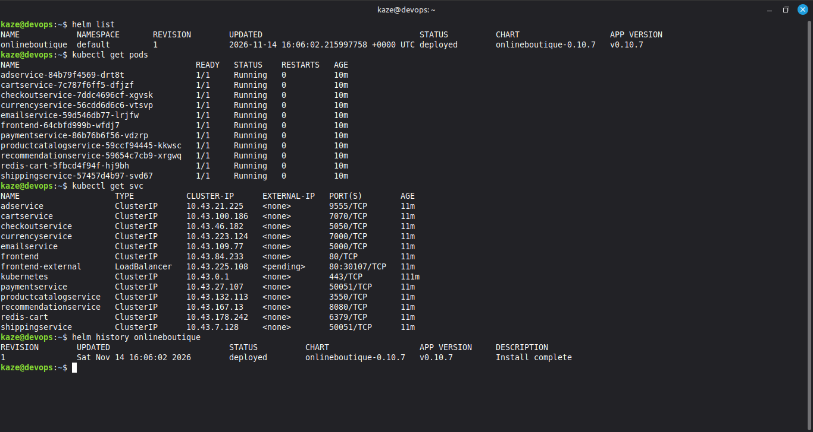
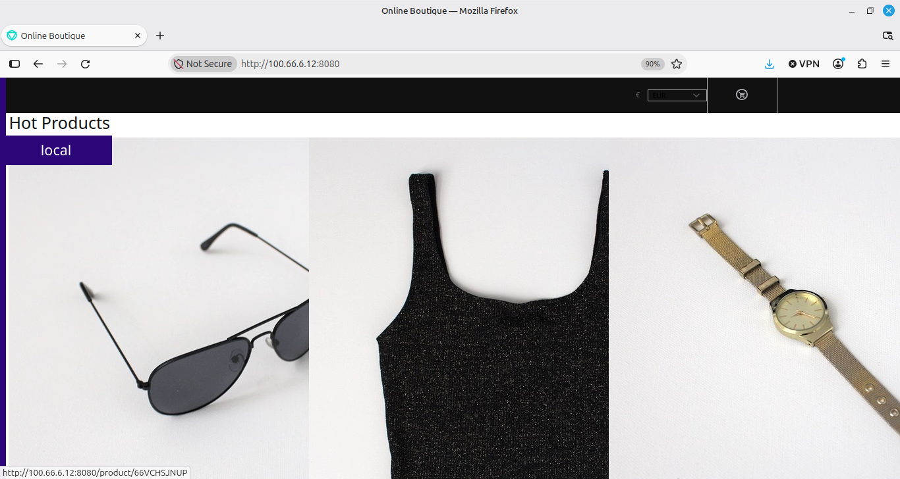
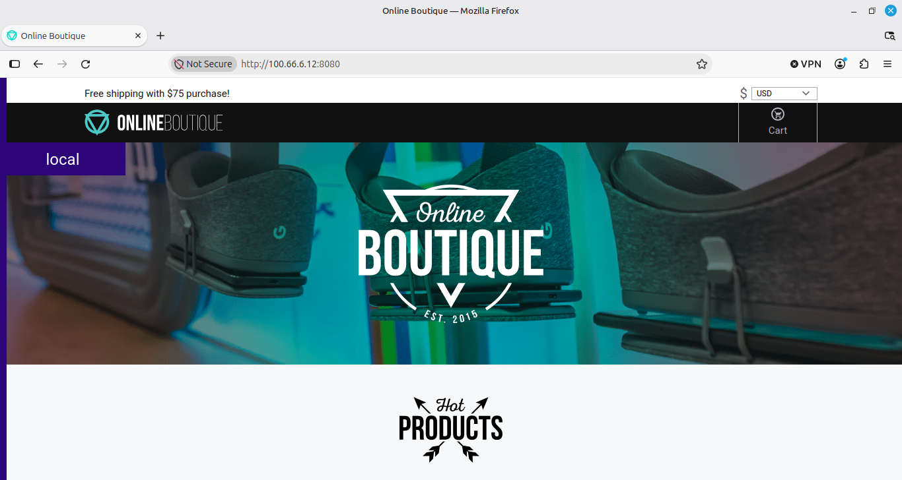
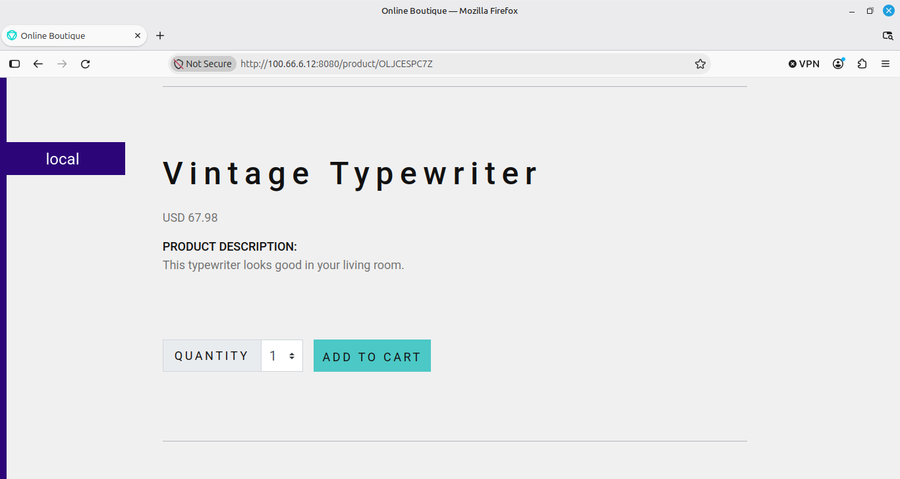
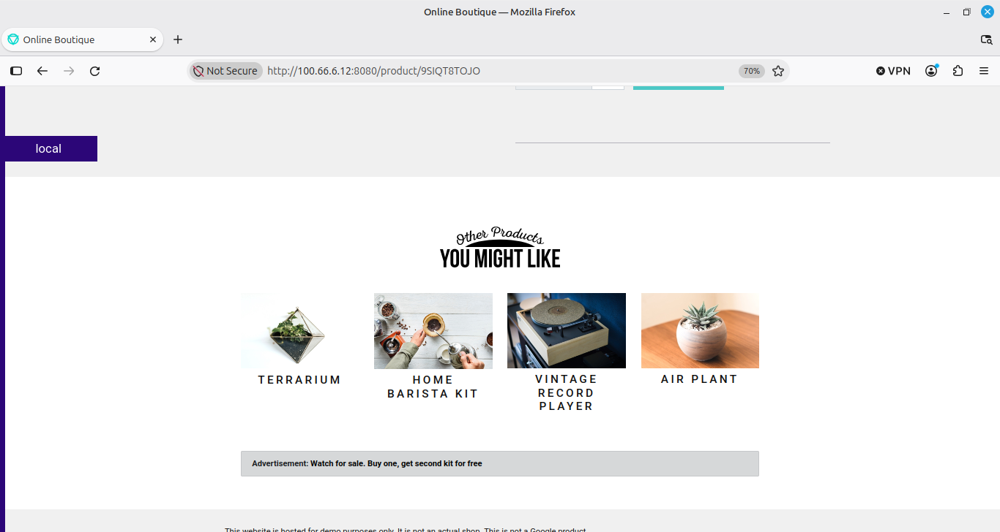
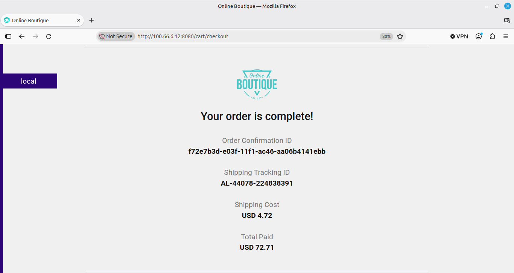

# Option 2: Helm Deployment on k3s

Deploys the Online Boutique microservice application (11 Deployments) to a single-node **k3s** cluster with **Helm**. Fully declarative: one values file, one install command, no post-install patching.

**Result:** 11/11 pods `Running`, about 800 MiB idle memory, `helm status` = `deployed`, install returns in about 10 seconds.

This is the second of two deployment paths in this repository. The first uses raw Kubernetes manifests (`kubectl apply -f config.yaml`): see [`../k8s-microservices/README.md`](../k8s-microservices/README.md). This path packages the same application for idempotent, parameterized installs. For the overall project summary, see the [root README](../README.md).

> **Attribution.** The application and the Helm chart (`onlineboutique` 0.10.7) come from Google's open-source [Online Boutique](https://github.com/GoogleCloudPlatform/microservices-demo) (Apache 2.0). The only file I authored in this directory is [`values-k3s.yaml`](values-k3s.yaml). This document covers how I validated, deployed, debugged, and operated the release.



## Contents

1. [What is in this directory](#what-is-in-this-directory)
2. [Prerequisites](#prerequisites)
3. [Deploy](#deploy)
4. [The storefront](#the-storefront)
5. [Security defaults](#security-defaults)
6. [Concepts: Helm terms](#concepts-helm-terms)
7. [Incidents](#incidents-what-broke-and-why)
8. [Failure triage](#failure-triage)
9. [Operations](#operations)
10. [Helm vs raw manifests](#helm-vs-raw-manifests)
11. [Design decisions](#design-decisions)

---

## What is in this directory

| Path | Purpose |
|---|---|
| [`helm-chart/`](helm-chart) | The `onlineboutique` chart: `Chart.yaml`, `values.yaml`, and one template per service |
| [`values-k3s.yaml`](values-k3s.yaml) | My overrides for a single-node, non-GCP cluster (the only file I wrote) |
| [`Steps.md`](Steps.md) | The original working notes this document was built from |
| `src/`, `protos/` | Service source code and gRPC contracts (upstream) |
| `kustomize/`, `terraform/`, `skaffold.yaml`, `cloudbuild.yaml`, `istio-manifests/`, `release/` | Retained from the upstream tree; not used by this k3s deployment |

## Prerequisites

| Resource | Minimum | Used here |
|---|---|---|
| RAM | 4 GB (8 GB safe) | 7.6 GB |
| vCPU | 4 | 4 |
| Disk | 20 GB | plenty |
| OS | Ubuntu 22.04+ or similar | Linux Mint |
| Network | Outbound to `us-central1-docker.pkg.dev` and `docker.io` | required |

Cluster prerequisites:

- k3s installed with `--disable traefik --disable servicelb --disable metrics-server`
- Node `Ready`; system pods (`coredns`, `local-path-provisioner`) `1/1 Running`
- Helm 3 installed
- No demo workloads running (`kubectl get pods` shows only system pods)

## Deploy

### 1. Install k3s and Helm

```bash
curl -sfL https://get.k3s.io | INSTALL_K3S_EXEC="--disable traefik --disable servicelb --disable metrics-server" sh -
curl https://raw.githubusercontent.com/helm/helm/main/scripts/get-helm-3 | bash
helm version
```

Helm reads `~/.kube/config`, but k3s writes its kubeconfig to `/etc/rancher/k3s/k3s.yaml`. Copy it before using Helm (see [Incident 1](#incident-1--helm-cannot-reach-the-cluster)):

```bash
mkdir -p ~/.kube
sudo cp /etc/rancher/k3s/k3s.yaml ~/.kube/config
sudo chown "$USER:$USER" ~/.kube/config
chmod 600 ~/.kube/config

kubectl get nodes
helm list          # must not print "connection refused"
```

### 2. Clone this repository

The chart is already in the repository, so there is no need to clone the upstream project.

```bash
git clone https://github.com/Dev-Gyinae/online-shop-microservices.git
cd online-shop-microservices/HelmCharts-microservice
ls helm-chart/       # Chart.yaml  README.md  templates/  values.yaml
```

### 3. Inspect the chart before overriding it

Helm **silently ignores** unknown keys in a values file: a wrong path raises no error, it simply does nothing. Confirm what the chart accepts first.

```bash
grep -E '^[a-zA-Z][a-zA-Z0-9_-]*:' helm-chart/values.yaml        # top-level keys
grep -n -A10 '^recommendationService:' helm-chart/values.yaml
grep -n -A8  '^loadGenerator:'        helm-chart/values.yaml
```

What chart `0.10.7` defaults to, and why it matters:

| Default | Value | Implication |
|---|---|---|
| `images.repository` | `us-central1-docker.pkg.dev/online-boutique-ci/microservices-demo` | Google's active CI registry with current tags |
| `images.tag` | `""` | Falls back to `Chart.appVersion` (`v0.10.7`) |
| `googleCloudOperations.profiler/tracing/metrics` | all `false` | The GCP agents that crash-looped the manifest path are already off |
| `recommendationService.resources` | 220Mi request, 450Mi limit | The memory tuning I discovered by hand for the manifest path is the chart default |
| `loadGenerator.create` | `true` | The one default that needs changing for a single-VM demo |

### 4. The values file

[`values-k3s.yaml`](values-k3s.yaml) has two overrides:

```yaml
# 1. No synthetic traffic on a demo VM
loadGenerator:
  create: false

# 2. Keep the GCP agents explicitly off (the chart default, stated for clarity
#    and so the intent is version-controlled)
googleCloudOperations:
  profiler: false
  tracing: false
  metrics: false
```

### 5. Render locally before touching the cluster

`helm template` renders the chart with no cluster contact and catches wrong-key overrides in seconds.

```bash
helm template onlineboutique ./helm-chart -f values-k3s.yaml > /tmp/render.yaml

grep 'image:' /tmp/render.yaml | sed 's/.*image: //' | sort -u     # images that will be pulled
grep -c '^kind: Deployment' /tmp/render.yaml                       # expect 11
```

The count is 11, not 10: ten application services plus the `redis-cart` Deployment created by `cartDatabase.inClusterRedis.create: true`. The load generator is absent. `frontend-external` is a Service, so it does not add to the count. Always count from the render, not from an assumed structure.

### 6. Pre-pull images

Pre-pulling separates registry failures from deployment failures. `ctr` needs fully qualified references (see [Incident 4](#incident-4--ctr-images-pull-fails-on-short-names)), so short names are expanded:

```bash
for img in $(grep 'image:' /tmp/render.yaml | sed 's/.*image: //' | tr -d '"' | sort -u); do
  case "$img" in */*) ;; *) img="docker.io/library/$img";; esac
  printf '\n=== %s ===\n' "$img"
  sudo k3s ctr images pull "$img" && echo "OK" || echo "FAILED"
done
```

The chart pins Redis by digest (`redis:alpine@sha256:...`); the loop pulls that exact reference.

### 7. Install (without `--wait`)

```bash
helm upgrade onlineboutique ./helm-chart \
  --install \
  --namespace default \
  -f values-k3s.yaml \
  --timeout 5m
```

Expected, returning in about 10 seconds:

```
Release "onlineboutique" does not exist. Installing it now.
NAME: onlineboutique
STATUS: deployed
REVISION: 1
```

`--wait` is omitted on purpose: it deadlocks on this cluster. See [Incident 2](#incident-2--helm-install---wait-hangs-in-pending-install).

### 8. Watch the pods

```bash
kubectl get pods -w
```

| Elapsed | State |
|---|---|
| 0 to 20 s | `ContainerCreating` (only Redis pulls; the rest are cached) |
| 20 to 60 s | most pods `Running 0/1`, then `1/1` |
| 60 to 120 s | `adservice` (a JVM) reaches `1/1` |
| 2 to 3 min | all running |

```bash
kubectl get pods --no-headers | awk '{print $2}' | sort | uniq -c    # 11  1/1
helm list                                                             # onlineboutique  1  deployed  onlineboutique-0.10.7
```

The screenshot at the top of this page shows the release, pods, services, and history after a clean install.

### 9. Expose the frontend

The chart creates `frontend-external` as `type: LoadBalancer`. With `--disable servicelb` it never receives an external IP; `<pending>` is expected, not an error. `port-forward` connects through the API server and bypasses it:

```bash
kubectl port-forward --address 0.0.0.0 svc/frontend-external 8080:80

curl -s -o /dev/null -w "HTTP %{http_code}\n" http://localhost:8080/     # HTTP 200
curl -s http://localhost:8080/ | grep -o '<title>[^<]*</title>'          # <title>Online Boutique</title>
```

Browse to `http://<vm-ip>:8080` (I used a Tailscale address to reach the VM from a laptop).

## The storefront

Product listing with the currency switched to EUR, served by the Helm release:



Home page and product pages (the same application, shown on the manifest deployment):





Recommendations and an advertisement:



Completed checkout:



| Action in the UI | Services exercised |
|---|---|
| Home page loads with prices | productcatalog, currency |
| Change currency | currencyservice |
| Open a product | productcatalog, recommendation |
| Add to cart / view cart | cartservice, redis-cart |
| Checkout | checkout, shipping, payment, email |

## Security defaults

What the chart provides and what is not enabled in this deployment:

- **Enabled by default:** the chart's pod templates run containers as non-root (UID 1000), drop all Linux capabilities, disallow privilege escalation, and use a read-only root filesystem (`securityContext.enable: true`; verified in the `frontend` template).
- **Available but off in `values-k3s.yaml`:** `networkPolicies.create`, `seccompProfile.enable` (`RuntimeDefault`), `authorizationPolicies.create` and `sidecars.create` (the last two need Istio).
- **Not present:** ingress and TLS. The storefront is plain HTTP over a port-forward.

## Concepts: Helm terms

| Term | Meaning |
|---|---|
| **Chart** | A packaged application: templates, default `values.yaml`, and metadata (`Chart.yaml`). |
| **Release** | One deployed instance of a chart. The same chart in several namespaces gives several independent releases. |
| **Revision** | Every `helm upgrade` bumps it. `helm rollback <release> <revision>` reverts. |
| **Values** | Overrides merged with chart defaults in order: chart `values.yaml`, then each `-f` file, then `--set`. Last wins. |
| **Template** | A Go template (`{{ .Values.x }}`) that renders to Kubernetes YAML. `helm template` runs it offline. |
| **`--install`** | Makes `helm upgrade` idempotent: install if the release does not exist, upgrade if it does. |
| **`--wait`** | Block until every rendered resource reports ready. Not always appropriate (Incident 2). |
| **`--timeout`** | How long Helm's API operations may take; distinct from resource readiness. |
| **`helm status`** | State of a release: `deployed`, `pending-install`, `pending-upgrade`, `failed`, `uninstalled`. |
| **OCI registry** | Charts can be distributed as OCI artifacts (`oci://...`). This chart is available that way, but the in-repo path is used here for reproducibility. |

---

## Incidents: what broke and why

Four Helm-specific failures. Two more (`recommendationservice` crash-looping and silent JSON-patch loss) occurred only on the manifest path and are documented in the [manifest README](../k8s-microservices/README.md#incidents-what-broke-why-and-how-it-was-fixed).

### Incident 1: Helm cannot reach the cluster

**Symptom**

```
Error: Kubernetes cluster unreachable: Get "http://localhost:8080/version":
  dial tcp 127.0.0.1:8080: connect: connection refused
```

**Root cause:** `kubectl` worked because the `k3s` binary is symlinked as `kubectl` and reads `/etc/rancher/k3s/k3s.yaml` itself. Helm has no such fallback: it looks at `~/.kube/config` or `$KUBECONFIG`, found neither, and defaulted to `http://localhost:8080`, the legacy kubectl default, which is not a k3s endpoint.

**Fix**

```bash
mkdir -p ~/.kube
sudo cp /etc/rancher/k3s/k3s.yaml ~/.kube/config
sudo chown "$USER:$USER" ~/.kube/config
chmod 600 ~/.kube/config
echo 'export KUBECONFIG=~/.kube/config' >> ~/.bashrc     # optional
```

**Why it works:** Helm and `kubectl` share the same client library. Once the path resolves to a readable file with a valid server URL and client certificate, both authenticate against the k3s API server.

### Incident 2: `helm install --wait` hangs in `pending-install`

**Symptom:** `helm upgrade onlineboutique ./helm-chart --install --wait --timeout 10m` blocks for 10 minutes while every pod is `1/1 Running`, then fails with `timed out waiting for the condition`. `helm status` reports `pending-install`.

**Root cause:** the chart creates `frontend-external` as a `LoadBalancer` Service. `--wait` blocks until every rendered resource is ready. With ServiceLB disabled no external IP is ever assigned, so Helm waits until the timeout. The pods are not the problem; the Service is.

**Fix** (two options):

1. Drop `--wait` and watch pods with `kubectl get pods -w`.
2. Re-enable ServiceLB in the k3s install, which costs about 15 MiB and adds `klipper-lb` pods.

For a demo VM that already uses `port-forward`, option 1 is cheaper.

**Why it works:** `--wait` is an all-or-nothing gate. On minimal clusters some resources (LoadBalancer Services, slow PVCs, custom resources with no reconciler) never become ready by design. `kubectl get pods -w` gives the same signal for the parts that matter.

**Recovery from a stuck release:**

```bash
helm uninstall onlineboutique
while kubectl get pods --no-headers 2>/dev/null | grep -qE 'Running|Pending|ContainerCreating'; do sleep 2; done
helm list     # must be empty before reinstalling
```

### Incident 3: Deployment count is 11, not 10

**Symptom:** the render check expected 10 Deployments (10 services, load generator disabled) and returned 11.

**Root cause:** `cartDatabase.inClusterRedis.create: true` renders a `redis-cart` Deployment. 10 application services plus Redis is 11.

**Fix:** correct the expectation; nothing changes in the values file.

**Lesson:** count from the render. `helm template` output is the truth.

### Incident 4: `ctr images pull` fails on short names

**Symptom**

```
ctr: failed to resolve image: parse "dummy://redis:alpine": invalid port ":alpine" after host
```

**Root cause:** `ctr` parses `redis:alpine` as host `redis`, port `alpine`. Docker resolves short names; containerd's `ctr` does not.

**Fix:** use `docker.io/library/redis:alpine`, or for a digest-pinned image `docker.io/library/redis:alpine@sha256:<digest>`. The pre-pull loop above does this automatically.

**Why it works:** containerd stores the image under the fully qualified name, the Deployment references the same name, and the kubelet finds it cached. The chart's own Redis reference was fine; only the manual pre-pull needed the full path.

---

## Failure triage

Run in order; each answer narrows the search.

```bash
kubectl get pods
```

| Status | Next step |
|---|---|
| `Pending` | `kubectl describe pod <name>`; Events for `Insufficient memory` or `Insufficient cpu` |
| `ContainerCreating` (over 30 s) | `kubectl describe pod <name>`; image pull, volume, or network |
| `Running 0/1` | `kubectl logs <name>`; readiness probe failing |
| `CrashLoopBackOff` | `kubectl logs <name> --previous` |
| `ImagePullBackOff` / `ErrImagePull` | `kubectl describe pod <name>`; wrong image or unreachable registry |
| `OOMKilled` (in describe) | Raise `limits.memory` |

```bash
kubectl describe pod <name> | tail -40       # Events: probe failures, pulls, scheduling, OOMKills
kubectl logs <name> --previous               # last crashed run
kubectl get endpoints                        # is each Service backed by pods?
kubectl exec -it <pod> -- nslookup <service> # DNS from inside a pod

helm status <release>                        # deployed / pending-install / failed
helm get manifest <release>                  # what Helm actually applied
helm get values <release>                    # user-supplied values only
helm history <release>                       # revisions, for rollback
```

**Rule of thumb:** the answer is in `kubectl describe` Events or `kubectl logs --previous` about 90% of the time. If neither helps, check endpoints and node resources.

## Operations

```bash
kubectl scale deployment --all --replicas=0     # stop the demo (keep objects)
kubectl scale deployment --all --replicas=1     # restart it

helm upgrade onlineboutique ./helm-chart --namespace default -f values-k3s.yaml --timeout 5m   # upgrade
helm history onlineboutique                     # list revisions
helm rollback onlineboutique                    # previous revision
helm rollback onlineboutique 2                  # a specific revision
helm uninstall onlineboutique                   # remove the release

/usr/local/bin/k3s-uninstall.sh                 # remove the cluster
```

## Helm vs raw manifests

| Aspect | Raw manifest | Helm |
|---|---|---|
| Auditability | `git diff` shows every YAML line | `values-k3s.yaml` shows only the overrides |
| Reusability | Copy and edit by hand | `helm upgrade --install -f values.yaml` is idempotent |
| Multiple environments | Separate manifest files | One chart plus `values-dev.yaml`, `values-prod.yaml` |
| Rollback | Re-apply a previous commit | `helm rollback onlineboutique <revision>` |
| Upstream updates | Diff and merge by hand | Update the chart source, then `helm upgrade` |
| Manual fixes during the original deployment | 4 (adservice tag, Redis image name, recommendationservice env and memory/probes) | 0 |
| Learning curve | Low (Kubernetes YAML) | Moderate (Go templates, values schema) |

The manifest path shows understanding of Kubernetes primitives; the Helm path shows packaging for repeatability. Both are in this repository on purpose.

## Design decisions

| Choice | Reason |
|---|---|
| In-repo chart instead of the OCI registry | No network dependency at install time; the chart is versioned beside the overrides; `helm show values ./helm-chart` works offline |
| `values-k3s.yaml` with two overrides | Chart `0.10.7` already defaults to GCP agents off and tuned memory, which I had to find by hand on the manifest path |
| `helm template` before every install | Helm ignores unknown keys silently; an offline render surfaces mistakes in seconds |
| `--wait` omitted | A `LoadBalancer` never becomes ready without ServiceLB, while the pods are ready long before Helm gives up |
| `port-forward` instead of the LoadBalancer | Bypasses the unprovisioned Service and the confusing `<pending>` external IP |
| Traefik, ServiceLB, metrics-server disabled | Saves roughly 200 MiB on a single-VM demo where none add value |
| Pre-pull images | Turns a hard-to-diagnose mid-deployment `ErrImagePull` into a single-command failure |
