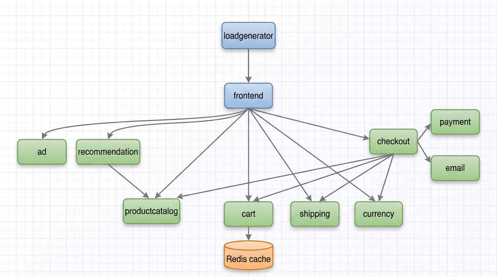
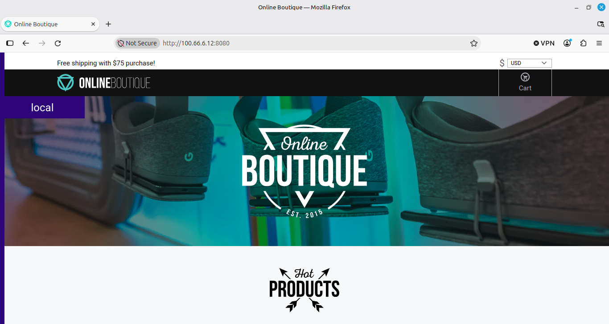
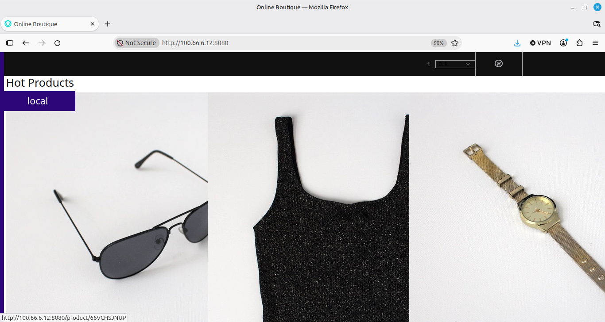
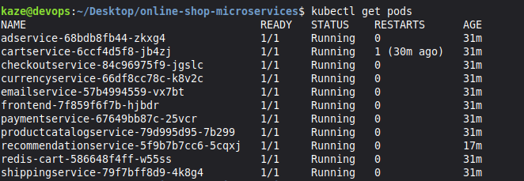
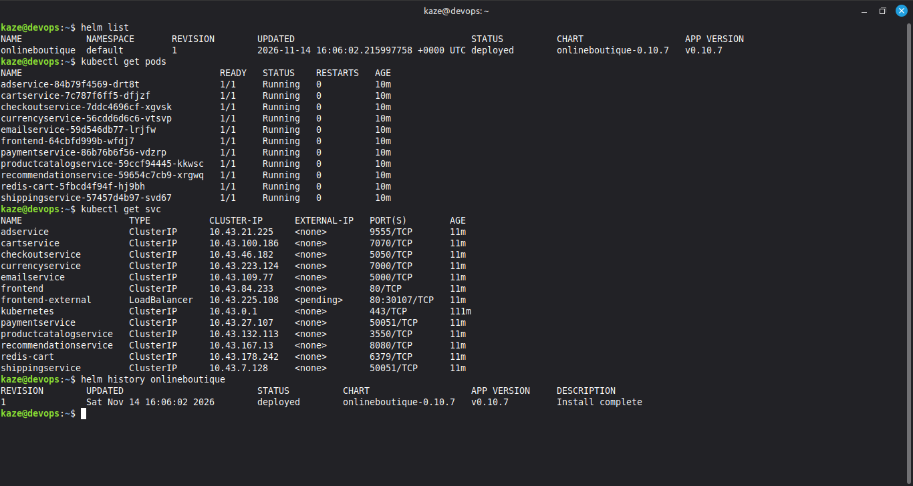

# Online Shop Microservices on Kubernetes (k3s)

Deployment and operations of an 11-service, polyglot e-commerce application on a single-node **k3s** cluster, delivered two ways: **raw Kubernetes manifests** and a **Helm chart**. Includes the full troubleshooting record from getting both paths to a clean, reproducible state.


> **Attribution.** The application is Google's open-source [Online Boutique](https://github.com/GoogleCloudPlatform/microservices-demo) (Apache 2.0). I did not write the application code. This repository documents my work deploying, packaging, debugging, and operating it on self-managed infrastructure outside GCP.

---

## Overview

| | |
|---|---|
| **Workload** | 11 Kubernetes Deployments: 10 application microservices plus an in-cluster Redis |
| **Languages in the workload** | Go, C#, Java, Node.js, Python |
| **Service communication** | gRPC (contracts in [`protos/demo.proto`](HelmCharts-microservice/protos/demo.proto)); HTTP for the web frontend |
| **Cluster** | Single-node k3s on a Linux VM (7.6 GB RAM, 4 vCPU), Traefik / ServiceLB / metrics-server disabled |
| **Delivery paths** | 1) `kubectl apply` of a single manifest, 2) Helm chart `onlineboutique-0.10.7` (app `v0.10.7`) |
| **Outcome (Helm path)** | 11/11 pods `Running`, `helm status` = `deployed`, install returns in about 10 seconds |

## What this project demonstrates

- Deploying a multi-language microservice system onto Kubernetes, from raw manifests through to a parameterized Helm release.
- Right-sizing a cluster: diagnosing a failed deployment on a 2 GB VM (control plane plus workload requests exceeded physical RAM) and resolving it with a capacity-based decision rather than guesswork.
- Root-cause debugging of real failures (image tags removed from a registry, containerd image-reference parsing, readiness/liveness probe timing, OOM kills, rolling-update deadlocks, Helm `--wait` hangs). Each is written up as symptom, root cause, fix, and why the fix works.
- Choosing between imperative patching and declarative configuration: the Helm path needs **zero** post-install patches, where the manifest path needed four.
- Writing operational documentation: a failure-triage runbook, a Kubernetes/Helm concepts reference, and recorded design decisions.

## Architecture



| Service | Language | Role |
|---|---|---|
| `frontend` | Go | HTTP server for the storefront; calls every other service over gRPC |
| `productcatalogservice` | Go | Serves the product list and search (backed by a JSON catalog) |
| `cartservice` | C# | Stores and retrieves shopping carts in Redis |
| `checkoutservice` | Go | Orchestrates an order: cart, catalog, currency, shipping, payment, email |
| `currencyservice` | Node.js | Currency conversion |
| `paymentservice` | Node.js | Mock card charging |
| `shippingservice` | Go | Shipping quotes and tracking (mock) |
| `emailservice` | Python | Order confirmation emails (mock) |
| `recommendationservice` | Python | Product recommendations based on the catalog |
| `adservice` | Java | Contextual text ads |
| `redis-cart` | Redis | In-cluster cart datastore |
| `loadgenerator` | Python (Locust) | Synthetic traffic. Disabled in the Helm deployment, not part of the raw manifest |

## Screenshots

| Storefront | Product listing (currency switched to EUR) |
|---|---|
|  |  |  | 

| Manifest deployment: all pods running | Helm deployment: release, pods, services, history |
|---|---|
|  |  |

## Repository layout

```
.
├── k8s-microservices/             # Path 1: raw-manifest deployment
│   ├── config.yaml                #   all Deployments and Services in one file
│   ├── README.md                  #   concepts, six incident write-ups, triage cheat sheet
│   └── Pics/                      #   architecture diagram and screenshots
└── HelmCharts-microservice/       # Path 2: Helm deployment (and the upstream source tree)
    ├── Steps.md                   #   step-by-step Helm runbook, incidents, design decisions
    ├── values-k3s.yaml            #   my environment overrides (the only file I authored here)
    ├── helm-chart/                #   chart: onlineboutique 0.10.7
    ├── protos/                    #   gRPC service definitions
    ├── src/                       #   service source code (upstream)
    └── kustomize/, terraform/,    #   retained from upstream; not used by the k3s
        skaffold.yaml, ...         #   deployments documented in this repository
```

## Quick start

### Prerequisites

- A Linux VM with at least 4 GB RAM (8 GB recommended), 4 vCPU, 20 GB disk
- Outbound access to `us-central1-docker.pkg.dev` and `docker.io`
- [k3s](https://k3s.io), `kubectl`, and [Helm 3](https://helm.sh/docs/intro/install/)

```bash
# Install k3s without the components this demo does not need
curl -sfL https://get.k3s.io | INSTALL_K3S_EXEC="--disable traefik --disable servicelb --disable metrics-server" sh -

# Helm reads ~/.kube/config, which k3s does not create
mkdir -p ~/.kube
sudo cp /etc/rancher/k3s/k3s.yaml ~/.kube/config
sudo chown "$USER:$USER" ~/.kube/config && chmod 600 ~/.kube/config
```

### Option A: Helm (recommended)

```bash
git clone https://github.com/Dev-Gyinae/online-shop-microservices.git
cd online-shop-microservices/HelmCharts-microservice

# Render locally first; no cluster contact, catches wrong-key overrides
helm template onlineboutique ./helm-chart -f values-k3s.yaml | grep -c '^kind: Deployment'   # expect 11

# Install (do not add --wait; see "Engineering notes")
helm upgrade onlineboutique ./helm-chart --install --namespace default -f values-k3s.yaml --timeout 5m

kubectl get pods -w     # all 11 reach 1/1 within 2-3 minutes (adservice's JVM is last)
```

`values-k3s.yaml` contains two overrides: the load generator is disabled, and the three Google Cloud agents (profiler, tracing, metrics) are explicitly set to `false`.

### Option B: Raw manifests

```bash
cd online-shop-microservices/k8s-microservices
kubectl apply -f config.yaml
```

**Known gap in this path:** `config.yaml` pins the older `v0.2.3` images, and `recommendationservice` as committed will crash-loop on a non-GCP host. After applying, run the fixes documented in [Incident 4](k8s-microservices/README.md):

```bash
kubectl set env deployment/recommendationservice DISABLE_PROFILER=1 DISABLE_TRACING=1 DISABLE_DEBUGGER=1
kubectl set resources deployment recommendationservice --requests=memory=220Mi --limits=memory=450Mi
kubectl patch deployment recommendationservice --type=json -p='[
  {"op":"replace","path":"/spec/template/spec/containers/0/readinessProbe/timeoutSeconds","value":10},
  {"op":"replace","path":"/spec/template/spec/containers/0/livenessProbe/timeoutSeconds","value":10}]'
```

### Access the storefront

`frontend-external` is a `LoadBalancer` Service. With ServiceLB disabled it never gets an external IP (`<pending>` is expected), so use a port-forward:

```bash
kubectl port-forward --address 0.0.0.0 svc/frontend-external 8080:80
# open http://localhost:8080  (or http://<vm-ip>:8080 from another machine)
```

### Verify end to end

| Action in the UI | Services exercised |
|---|---|
| Load the home page | productcatalog, currency |
| Change currency | currencyservice |
| Open a product | productcatalog, recommendation |
| Add to cart / view cart | cartservice, redis-cart |
| Complete checkout | checkout, shipping, payment, email |

### Operate and clean up

```bash
helm history onlineboutique            # revisions
helm rollback onlineboutique 1         # roll back
helm uninstall onlineboutique          # remove the release
/usr/local/bin/k3s-uninstall.sh        # remove the cluster
```

## Engineering notes: what broke and why

Full write-ups, with logs and reasoning, are in [`k8s-microservices/README.md`](k8s-microservices/README.md) and [`HelmCharts-microservice/Steps.md`](HelmCharts-microservice/Steps.md).

| # | Failure | Root cause | Resolution |
|---|---|---|---|
| 1 | Dozens of `Pending` pods, duplicate ReplicaSets, cascading `CrashLoopBackOff` / `ErrImagePull` on a 2 GB VM | k3s control plane plus workload requests exceeded physical RAM; a rolling update deadlocked because new pods could not schedule | Moved to a 7.6 GB VM. Swap would not help: the scheduler places pods on requests, not swap |
| 2 | `adservice` `ErrImagePull: not found` | The pinned `v0.2.3` tag had been removed from the registry | Pinned `v0.4.1`; the `GetAds` gRPC contract is unchanged, so the older frontend still works |
| 3 | `ctr images pull redis:alpine` fails with `invalid port ":alpine"` | `ctr` does not do Docker-style short-name resolution and parses `redis` as a host | Use fully qualified references (`docker.io/library/redis:alpine`) |
| 4 | `recommendationservice` stuck in `CrashLoopBackOff` | Three chained causes: GCP Profiler/Tracing/Debugger agents blocking on an unreachable metadata server, 1 s probe timeouts killing the pod before it bound its port, and a 250 Mi limit OOMing during Python imports | Disabled the agents, raised probe timeouts to 10 s, raised memory limit to 450 Mi |
| 5 | Several ReplicaSets competing, none becoming ready | Every patch changes the pod template and spawns a new ReplicaSet; a rolling update cannot finish while new pods stay unready | Scale to 0, wait for pods to clear, scale to 1 so state converges |
| 6 | A JSON Patch adding three env vars applied only one | Multiple `/env/-` appends against one array in a single patch are not reliable | `kubectl set env` (declarative and idempotent), then verify with `-o jsonpath` |
| 7 | `helm install --wait` hangs in `pending-install` for the full timeout | The `LoadBalancer` Service can never become "ready" with ServiceLB disabled, although every pod is healthy | Dropped `--wait`; watch pods directly |
| 8 | `helm list` returns `connection refused` on `localhost:8080` | Helm looks in `~/.kube/config` and `$KUBECONFIG`; k3s writes elsewhere (`kubectl` worked only because k3s bundles it) | Copied the kubeconfig to the standard path |

## Design decisions

| Decision | Reason |
|---|---|
| Local chart path instead of the OCI registry | No network dependency at install time; the chart is versioned alongside the overrides |
| `values-k3s.yaml` limited to two overrides | Chart `v0.10.7` already defaults to GCP agents off and tuned memory limits, which I had to discover by hand in the manifest path |
| `helm template` before every install | Helm silently ignores unknown values keys; rendering offline surfaces mistakes in seconds |
| Pre-pull images with `ctr` | Turns a mid-deployment `ErrImagePull` into an immediate, isolated failure |
| `port-forward` instead of a LoadBalancer | Avoids a permanently `<pending>` external IP on a cluster without ServiceLB |
| Disable Traefik, ServiceLB, metrics-server | Saves roughly 200 MiB on a single-VM demo where none of them add value |

## Security posture

What is in place, and what is not, in this deployment:

- **Pod hardening from the chart (enabled by default):** the chart's pod templates run containers as non-root (UID 1000), drop all Linux capabilities, disallow privilege escalation, and use a read-only root filesystem (verified in the `frontend` template).
- **Not enabled in `values-k3s.yaml`:** NetworkPolicies, the `RuntimeDefault` seccomp profile, Istio authorization policies and sidecars. The chart supports them, and the upstream tree includes a `network-policies` Kustomize component.
- **No TLS or ingress.** The storefront is served over plain HTTP via port-forward, and was reached remotely over a private mesh network (Tailscale). This is a lab setup, not a production exposure.
- Payment, email, and shipping services are mocks; no real card or customer data is processed.

## Roadmap

Planned work, not yet implemented:

- [ ] CI pipeline (GitHub Actions): `helm lint`, `helm template`, and manifest validation on every push
- [ ] Container image and manifest scanning (Trivy, kube-linter or Checkov) as a gating CI step
- [ ] Enable `networkPolicies.create` and `seccompProfile.enable` in `values-k3s.yaml` and verify the app under default-deny
- [ ] Bake the `recommendationservice` fixes and current image tags into `config.yaml` so the manifest path works without post-apply patches
- [ ] Ingress with TLS in place of port-forward
- [ ] Metrics and dashboards (Prometheus and Grafana)
- [ ] GitOps delivery (Argo CD or Flux)

## Acknowledgements and license

- Application and Helm chart: [GoogleCloudPlatform/microservices-demo](https://github.com/GoogleCloudPlatform/microservices-demo), licensed under the Apache License 2.0. Upstream license headers are retained in the source files.
- Deployment, debugging, and documentation in this repository: [Samuel Gyinae](https://github.com/Dev-Gyinae).
