# Option 1: Raw Kubernetes Manifests on k3s

Deploys the Online Boutique microservice application to a single-node **k3s** cluster using one plain manifest (`config.yaml`) and `kubectl apply`. No Helm, no templating: every Deployment and Service is visible in a single file.

**Result:** 11 Deployments (10 application services plus `redis-cart`), all `1/1 Running`, reachable through `kubectl port-forward`.

This is the first of two deployment paths in this repository. The second packages the same application with Helm: see [`../HelmCharts-microservice/README.md`](../HelmCharts-microservice/README.md). For the overall project summary, see the [root README](../README.md).

> **Attribution.** The application is Google's open-source [Online Boutique](https://github.com/GoogleCloudPlatform/microservices-demo) (Apache 2.0). This document covers how I deployed, debugged, and operated it, not the application code.

## Contents

1. [Architecture](#architecture)
2. [Prerequisites](#prerequisites)
3. [Deploy](#deploy)
4. [What a healthy deployment looks like](#what-a-healthy-deployment-looks-like)
5. [The storefront](#the-storefront)
6. [Concepts used in this project](#concepts-used-in-this-project)
7. [Incidents: what broke, why, and how it was fixed](#incidents-what-broke-why-and-how-it-was-fixed)
8. [Failure triage cheat sheet](#failure-triage-cheat-sheet)
9. [Operations and cleanup](#operations-and-cleanup)
10. [Known limitations](#known-limitations)

---

## Architecture

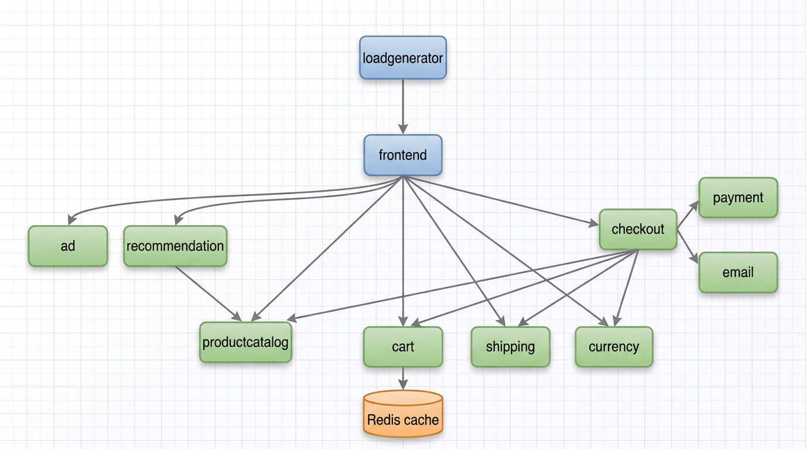

The frontend talks to every backend service over gRPC. `checkoutservice` orchestrates an order across cart, catalog, currency, shipping, payment, and email. `cartservice` persists carts in Redis.

| File | Contents |
|---|---|
| [`config.yaml`](config.yaml) | 11 Deployments and 12 Services (including `frontend-external`), about 630 lines |
| [`Pics/`](Pics) | Architecture diagram and screenshots used in this document |

Images used by the manifest: ten services from `gcr.io/google-samples/microservices-demo` (tag `v0.2.3`, except `adservice` at `v0.4.1`) and `redis:alpine`.

## Prerequisites

| Resource | Minimum | Used here |
|---|---|---|
| RAM | 8 GB recommended (see Incident 1) | 7.6 GB |
| vCPU | 4 | 4 |
| Disk | 20 GB | plenty |
| OS | Ubuntu 22.04+ or similar | Linux Mint |
| Network | Outbound to `gcr.io` and `docker.io` | required |

## Deploy

### 1. Install k3s

Traefik, ServiceLB, and metrics-server are disabled to save memory; none of them add value for a single-VM demo.

```bash
curl -sfL https://get.k3s.io | INSTALL_K3S_EXEC="--disable traefik --disable servicelb --disable metrics-server" sh -

kubectl get nodes          # Ready
kubectl get pods -A        # coredns and local-path-provisioner 1/1 Running
```

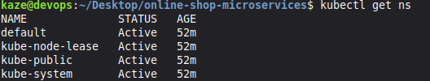

### 2. Clone the repository

```bash
git clone https://github.com/Dev-Gyinae/online-shop-microservices.git
cd online-shop-microservices/k8s-microservices
```

### 3. Pre-pull images

Pre-pulling turns a mid-deployment `ErrImagePull` into an immediate, isolated failure. `ctr` needs fully qualified references, so short names such as `redis:alpine` are expanded:

```bash
for img in $(grep -E '^\s+image:' config.yaml | awk '{print $2}' | sort -u); do
  case "$img" in */*) ;; *) img="docker.io/library/$img";; esac
  printf '\n=== %s ===\n' "$img"
  sudo k3s ctr images pull "$img" && echo "OK" || echo "FAILED"
done
```

### 4. Apply the manifest

```bash
kubectl apply -f config.yaml
kubectl get pods -w
```

### 5. Apply the `recommendationservice` fixes (required)

`config.yaml` as committed uses the `v0.2.3` Python image, which enables Google Cloud agents that hang on a non-GCP host. Without these changes `recommendationservice` crash-loops (full analysis in [Incident 4](#incident-4--recommendationservice-crashloopbackoff)):

```bash
kubectl set env deployment/recommendationservice \
  DISABLE_PROFILER=1 DISABLE_TRACING=1 DISABLE_DEBUGGER=1

kubectl set resources deployment recommendationservice \
  --requests=memory=220Mi --limits=memory=450Mi

kubectl patch deployment recommendationservice --type=json -p='[
  {"op":"replace","path":"/spec/template/spec/containers/0/readinessProbe/timeoutSeconds","value":10},
  {"op":"replace","path":"/spec/template/spec/containers/0/livenessProbe/timeoutSeconds","value":10}]'

# Verify the env vars actually landed
kubectl get deployment recommendationservice \
  -o jsonpath='{.spec.template.spec.containers[0].env}' | python3 -m json.tool
```

If the pod is already stuck after earlier attempts, clear accumulated ReplicaSets first: scale to 0, wait for the pod to disappear, then scale to 1 (see [Incident 5](#incident-5--duplicate-replicasets-and-a-rolling-update-deadlock)).

### 6. Expose the frontend

`frontend-external` is a `LoadBalancer` Service. With ServiceLB disabled it never receives an external IP, and `<pending>` is expected. Use a port-forward, which tunnels through the Kubernetes API server:

```bash
kubectl port-forward --address 0.0.0.0 svc/frontend-external 8080:80
```

Open `http://localhost:8080`, or `http://<vm-ip>:8080` from another machine.

## What a healthy deployment looks like

All 11 pods `Running`:

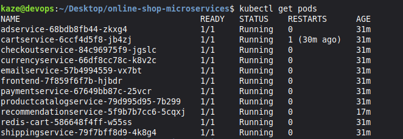

All 11 Deployments available:

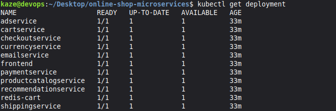

Services: every backend is `ClusterIP`; `frontend-external` is a `LoadBalancer` whose `EXTERNAL-IP` stays `<pending>` by design:

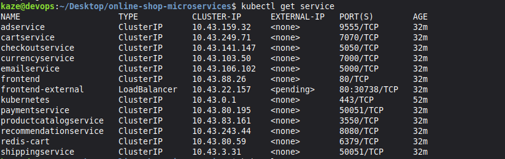

Endpoints: every Service is backed by a pod IP. An empty endpoint list is the quickest sign a Service has no healthy pods:

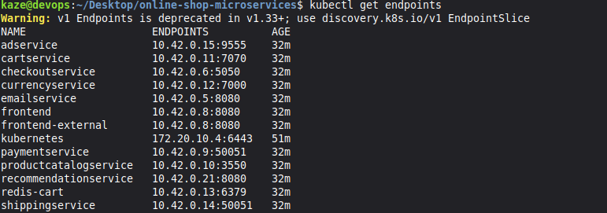

## The storefront

Home page, served through the port-forward:


Product listing, with prices from `productcatalogservice` and currency conversion from `currencyservice`:

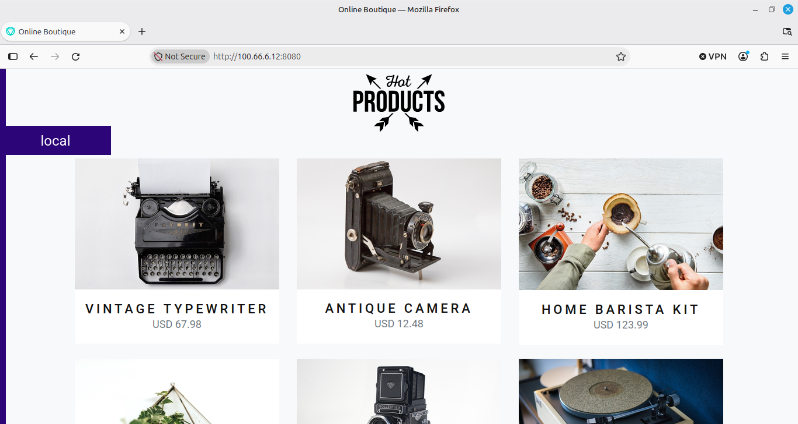

Product page with quantity selector and add-to-cart:

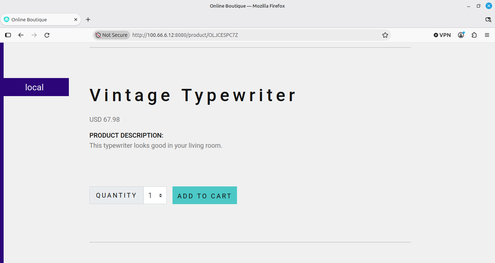

Recommendations (`recommendationservice`) and an advertisement (`adservice`):

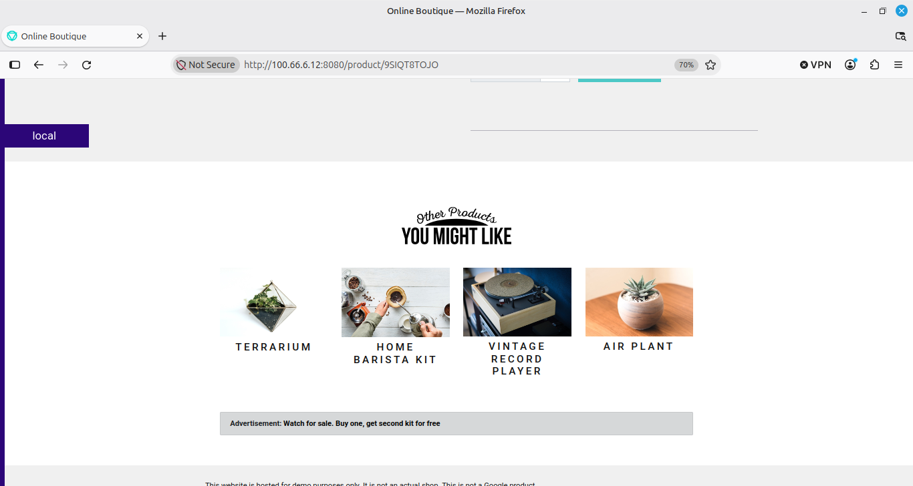

Completed checkout, which exercises checkout, cart, shipping, payment, and email in one request:

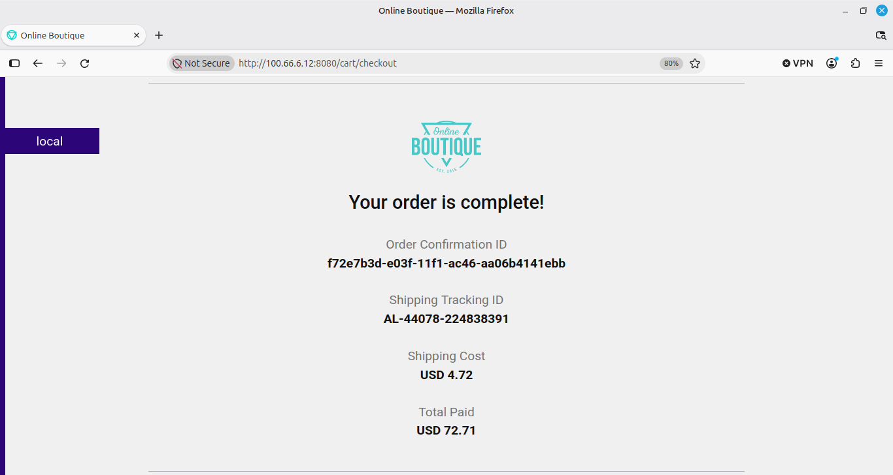

| Action in the UI | Services exercised |
|---|---|
| Load the home page | productcatalog, currency |
| Change currency | currencyservice |
| Open a product | productcatalog, recommendation, ad |
| Add to cart / view cart | cartservice, redis-cart |
| Complete checkout | checkout, shipping, payment, email |

---

## Concepts used in this project

Vocabulary that appears in `kubectl` output and in the incidents below.

### Core objects

| Term | What it is |
|---|---|
| **Pod** | Smallest deployable unit: one or more containers sharing a network namespace and storage. Pods are ephemeral. |
| **Deployment** | Declares what a pod should look like and how many should run. Manages rolling updates. |
| **ReplicaSet** | Created by a Deployment; owns the actual pods. Every pod-template change creates a new ReplicaSet, and old ones remain until their pods terminate. |
| **Service** | Stable virtual IP and DNS name in front of a set of pods. `frontend` stays reachable at `frontend:80` as pods come and go. |
| **Endpoints / EndpointSlice** | The pod IPs a Service routes to. `<none>` means no healthy backing pods. |
| **Namespace** | Logical partition. Everything here runs in `default`; k3s system pods live in `kube-system`. |

### Pod lifecycle states

| State | Meaning |
|---|---|
| `Pending` | The scheduler cannot place the pod, usually insufficient CPU or memory on every node. |
| `ContainerCreating` | Scheduled; the runtime is pulling the image, mounting volumes, or setting up networking. |
| `Running 0/1` | Container is up but the readiness probe is failing, so it receives no traffic. |
| `Running 1/1` | Ready and included in the Service endpoints. |
| `Completed` | Exited with code 0 (normal for Jobs). |
| `CrashLoopBackOff` | Container keeps exiting non-zero. Kubernetes backs off between restarts (10s, 20s, 40s, up to 5 min). |
| `ErrImagePull` / `ImagePullBackOff` | Image cannot be pulled (registry unreachable, tag missing, auth failure); the second is the backed-off retry state. |
| `OOMKilled` | The kernel killed the container for exceeding its memory limit (exit code 137). |

### Probes

| Term | Purpose | On failure |
|---|---|---|
| **Readiness probe** | Is the pod ready to receive traffic? | Stays `0/1` and is removed from endpoints, but is not restarted. |
| **Liveness probe** | Is the pod still alive? | Killed and restarted; repeated failures lead to `CrashLoopBackOff`. |
| `timeoutSeconds` | How long a probe waits (default 1s). | A slow-starting app fails every probe and is killed. |
| `initialDelaySeconds` | Grace period before the first probe. | Without it, a slow app is killed before it starts. |

### Exit codes

| Code | Meaning |
|---|---|
| `0` | Clean exit |
| `1` | Application error |
| `137` | `SIGKILL`, almost always OOMKilled |
| `143` | `SIGTERM`, graceful shutdown request (a kubelet kill after probe failure lands here) |

### Tools

| Term | What it is |
|---|---|
| **k3s** | A CNCF-certified Kubernetes distribution shipped as a single binary with containerd, CoreDNS, and a local storage provisioner. |
| **containerd / `ctr`** | The container runtime k3s uses, and its low-level CLI. Unlike `docker pull`, `ctr` requires fully qualified image paths. |
| **`kubectl port-forward`** | Tunnels a local port to a Service or Pod through the API server. `--address 0.0.0.0` listens on all interfaces. |
| **QoS class** | Eviction priority. `Burstable` = requests differ from limits; `Guaranteed` = equal; `BestEffort` = none set. |
| **Rolling update** | Create a new ReplicaSet, scale it up, scale the old one down. Stalls if new pods never become ready. |

---

## Incidents: what broke, why, and how it was fixed

Six real failures from this deployment. Each follows the same structure: symptom, root cause, fix, why the fix works.

### Incident 1: Full deployment on a 2 GB VM

**Symptom**

```
NAME                            READY   STATUS              RESTARTS
adservice-679967db4b-tmmch      0/1     Running             0
adservice-84b79f4569-zx5s6      0/1     Running             0     <- two ReplicaSets
cartservice-574c7f4cdd-fb9bq    0/1     Pending             0
frontend-65c9648564-h5ss8       0/1     CrashLoopBackOff    5
redis-cart-586648f4ff-tbv8n     0/1     ErrImagePull        0
```

Many `Pending` pods, two ReplicaSets per Deployment running at once, and `frontend` and `recommendationservice` crash-looping.

**Root cause**

The k3s control plane (about 480 MiB) plus 11 demo pods (about 800 MiB of requests, about 1.75 GiB of limits) exceeds 2 GB of physical RAM. A rolling update deadlocked: new pods could not schedule, so old pods were never terminated, and both ReplicaSets held memory in a loop. The `ErrImagePull` on `redis-cart` and the `CrashLoopBackOff` on `frontend` were cascading symptoms of memory exhaustion, not separate bugs.

**Fix:** move to a VM with at least 8 GB of RAM.

**Why it works:** the scheduler can place every pod, so rolling updates complete and old ReplicaSets scale to zero on their own. Swap would not have helped, because the scheduler places pods on requests, which are hard values, not on swap.

### Incident 2: `adservice` `ErrImagePull: not found`

**Symptom**

```
Failed to pull image "gcr.io/google-samples/microservices-demo/adservice:v0.2.3": not found
```

**Root cause:** the registry no longer carries the `v0.2.3` tag for `adservice`. The other ten services on `v0.2.3` still exist.

**Fix**

```bash
sudo k3s ctr images pull gcr.io/google-samples/microservices-demo/adservice:v0.4.1
sed -i 's|adservice:v0\.2\.3|adservice:v0.4.1|' config.yaml
```

**Why it works:** the `AdService.GetAds` gRPC signature is unchanged between the two versions, so the older frontend calls the newer `adservice` without code changes. Pre-pulling before `kubectl apply` isolates this failure instead of leaving a pod to debug.

### Incident 3: `redis-cart` `invalid port ":alpine" after host`

**Symptom**

```
ctr: failed to resolve image: parse "dummy://redis:alpine": invalid port ":alpine" after host
```

**Root cause:** `ctr` parses `redis:alpine` as host `redis`, port `alpine`. `docker pull` accepts short names because Docker resolves registries itself; `ctr` does not.

**Fix:** `sudo k3s ctr images pull docker.io/library/redis:alpine` (the pre-pull loop above does this automatically).

**Why it works:** `docker.io/library/redis:alpine` is a fully qualified reference, so containerd stores it under that name and the kubelet finds it at pod start.

The short name in the manifest would have worked in-cluster, because kubelet and containerd do their own short-name resolution. Only the `ctr` pre-pull failed.

### Incident 4: `recommendationservice` `CrashLoopBackOff`

The hardest one: three problems chained together.

**Symptom**

```
recommendationservice-5995f559bb-9g7g7   0/1   CrashLoopBackOff   6 (1s ago)   5m14s
```

`kubectl logs --previous`:

```
{"message": "Profiler enabled."}
WARNING:google.auth.compute_engine._metadata: Compute Engine Metadata server unavailable on attempt 1 of 3. Reason: timed out
{"message": "Sleeping 10 seconds to retry Stackdriver Profiler agent initialization"}
```

`kubectl describe`:

```
Readiness probe failed: command timed out: "/bin/grpc_health_probe -addr=:8080" timed out after 1s
Killing: Container server failed liveness probe, will be restarted
```

**Root cause**

1. The `v0.2.3` Python image enables three Google Cloud agents by default (Profiler, Tracing, Debugger). Each contacts the GCP metadata server at `169.254.169.254`, which times out on a non-GCP host.
2. Each agent handles the timeout differently: Profiler retries three times then sleeps 10 seconds, Tracing gives up quietly, and Debugger hangs indefinitely.
3. The probe timeout was 1 second. The app had not yet bound `:8080`, so every liveness probe failed, the kubelet sent `SIGTERM`, and the container restarted. The pod was killed before it could ever start.

**Fix: all of these are required**

```bash
kubectl set env deployment/recommendationservice DISABLE_PROFILER=1 DISABLE_TRACING=1 DISABLE_DEBUGGER=1

kubectl patch deployment recommendationservice --type=json -p='[
  {"op":"replace","path":"/spec/template/spec/containers/0/readinessProbe/timeoutSeconds","value":10},
  {"op":"replace","path":"/spec/template/spec/containers/0/livenessProbe/timeoutSeconds","value":10}]'

kubectl set resources deployment recommendationservice --requests=memory=220Mi --limits=memory=450Mi

kubectl scale deployment recommendationservice --replicas=0   # wait for pods to clear
kubectl scale deployment recommendationservice --replicas=1
```

**Why it works**

- With the `DISABLE_*` flags the service skips agent initialization and binds `:8080` in about 5 seconds instead of never.
- 10 second probe timeouts give the Python interpreter room to import libraries and start the gRPC server.
- A 450 MiB limit prevents an OOM kill during the initial import spike (250 MiB was not enough).
- Scaling to zero and back clears ReplicaSets left over from earlier patch attempts, so all patches converge before the new pod is created.

**Verify** that the flags landed (see Incident 6): the env list must contain `PORT`, `PRODUCT_CATALOG_SERVICE_ADDR`, `DISABLE_PROFILER`, `DISABLE_TRACING`, and `DISABLE_DEBUGGER`. If any `DISABLE_*` flag is missing, the pod crash-loops again even with the probe and memory fixes.

Kubernetes events during this deployment, showing the probe failures:

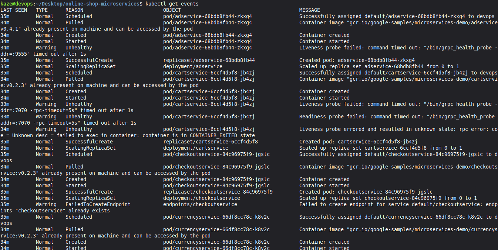

### Incident 5: Duplicate ReplicaSets and a rolling-update deadlock

**Symptom**

```
NAME                               DESIRED   CURRENT   READY   AGE
recommendationservice-56c58657c5   1         1         0       4m7s
recommendationservice-56c79bbfb    1         1         0       4m18s
recommendationservice-5995f559bb   0         0         0       10m
recommendationservice-85d9d5dccb   0         0         0       6m21s
```

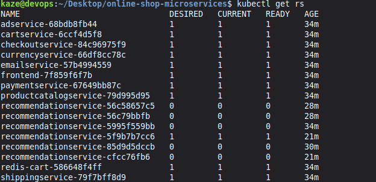

**Root cause:** every `kubectl patch` or `kubectl set env` changes the pod template, creating a new ReplicaSet and triggering a rolling update. If the new pods never become ready, the old ReplicaSet keeps its pods alive, and each patch attempt adds another ReplicaSet. After four patches, four ReplicaSets competed for one node.

**Fix**

```bash
kubectl scale deployment recommendationservice --replicas=0
while kubectl get pods -l app=recommendationservice --no-headers 2>/dev/null | grep -q .; do sleep 2; done
kubectl scale deployment recommendationservice --replicas=1

# Optionally remove stale ReplicaSets (only those with DESIRED=0)
kubectl get rs -l app=recommendationservice
```

**Why it works:** scaling to zero forces every ReplicaSet to zero pods; scaling back to one creates exactly one pod from the newest ReplicaSet, whose spec includes every patch applied so far.

**Lesson:** never keep patching a Deployment that is already failing a rolling update. Fix the root cause and scale to zero and back, or delete and re-apply.

### Incident 6: JSON Patch on the `env` array silently dropped entries

**Symptom:** a single patch with several `{"op":"add","path":".../env/-", ...}` operations applied only the first entry. The resulting env list had `DISABLE_PROFILER` but not `DISABLE_TRACING` or `DISABLE_DEBUGGER`.

**Root cause:** the `-` path means "append to the end of the array". Several appends against the same array in one JSON patch can resolve to the same index during serialization, and one overwrites the other. This is a known sharp edge of JSON Patch (RFC 6902) on arrays.

**Fix:** use `kubectl set env`, which computes the final desired state server-side:

```bash
kubectl set env deployment/recommendationservice DISABLE_PROFILER=1 DISABLE_TRACING=1 DISABLE_DEBUGGER=1
```

**Why it works:** it resolves to "ensure these keys exist with these values", with no indexing and no race. Running it twice gives the same result, whereas running an append patch twice adds duplicates.

**Lesson:** use `kubectl set env` for environment variables and reserve raw JSON Patch for scalar paths (`/timeoutSeconds`, `/limits/memory`). After any env patch, verify:

```bash
kubectl get deployment <name> -o jsonpath='{.spec.template.spec.containers[0].env}' | python3 -m json.tool
```

A `deployment.apps/foo patched` message does not prove every operation applied.

---

## Failure triage cheat sheet

Run these in order; each answer narrows the search.

```bash
kubectl get pods                       # 1. what is broken?
```

| Status | Next step |
|---|---|
| `Pending` | `kubectl describe pod <name>`; check Events for `Insufficient memory` or `Insufficient cpu` |
| `ContainerCreating` (over 30 s) | `kubectl describe pod <name>`; image pull, volume mount, or network |
| `Running 0/1` | `kubectl logs <name>`; readiness probe failing (app not ready or wrong port) |
| `CrashLoopBackOff` | `kubectl logs <name> --previous`; read the last error |
| `ImagePullBackOff` / `ErrImagePull` | `kubectl describe pod <name>`; wrong image name or unreachable registry |
| `OOMKilled` (in describe) | Raise `limits.memory` on the Deployment |

```bash
kubectl describe pod <name> | tail -40          # 2. primary diagnostic: the Events block
kubectl logs <name>                              # 3. application logs
kubectl logs <name> --previous                   #    last crashed run
kubectl get endpoints                            # 4. is each Service backed by pods?
kubectl exec -it <pod> -- nslookup <service>     #    can a pod resolve a Service?
kubectl get pods -A                              # 5. cluster-wide: is kube-system healthy?
kubectl get events --sort-by=.metadata.creationTimestamp | tail -20
free -h                                          #    is the node out of memory?
df -h /var/lib/rancher                           #    is the disk full?
```

**Rule of thumb:** the answer is in `kubectl describe` Events or `kubectl logs --previous` about 90% of the time. If neither helps, it is a networking or scheduling problem: check endpoints and node resources.

## Operations and cleanup

```bash
kubectl scale deployment --all --replicas=0     # stop the demo, keep objects
kubectl scale deployment --all --replicas=1     # restart it
kubectl delete -f config.yaml                   # remove all demo resources
/usr/local/bin/k3s-uninstall.sh                 # remove the cluster
```

## Known limitations

- `config.yaml` does not contain the `recommendationservice` fixes; they are applied after `kubectl apply` (step 5). Baking them into the manifest would make this path a single command.
- Images are pinned to older tags (`v0.2.3`, with `adservice` at `v0.4.1`). The Helm path runs `v0.10.7` and needs none of the patches.
- HTTP only, through a port-forward. There is no ingress or TLS.
- No NetworkPolicies, PodSecurity settings, or resource quotas are defined in this manifest.
